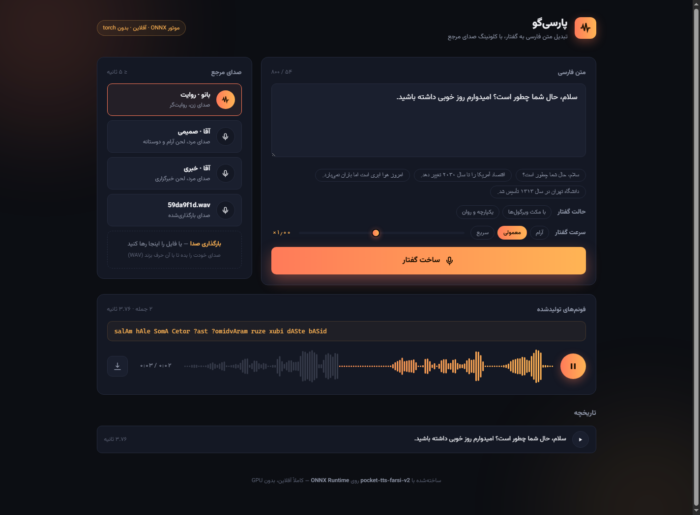

# پارسی‌گو — نسخهٔ ویندوز 🪟

**تبدیل متن فارسی به گفتار، با کلونینگ صدا، کاملاً آفلاین و روی CPU.**

این مخزن، **نسخهٔ ویندوزی** پروژهٔ
[`nimaone/persian_tts`](https://github.com/nimaone/persian_tts) است: همان موتور ONNX
(`pocket-tts-farsi-v2` + `Homo-GE2PE-Persian`)، اما به‌شکل یک **برنامهٔ دسکتاپ ویندوز** —
دوبار کلیک، پنجرهٔ بومی، پنجرهٔ نصب مدل، دیالوگ ذخیرهٔ ویندوز، و یک `.exe` که پایتون همراهش
دارد و به نصب چیزی نیاز ندارد.

|  |  |
|---|---|
| 🖥 سیستم | ویندوز ۱۰ (۱۸۰۹+) یا ۱۱ — ۶۴ بیتی |
| ⚡ اجرا | ONNX Runtime روی CPU — بدون GPU، بدون torch |
| 📦 حجم | ~۲۰۰ مگابایت برنامه + ~۴۷۰ مگابایت مدل (یک‌بار) |
| 🔌 اینترنت | فقط برای دانلود مدل؛ بعد از آن هیچ ارتباطی بیرون نمی‌رود |
| 🎙 صداها | سه صدای داخلی + **کلونینگ** هر نمونهٔ ۵ ثانیه‌ای شما |



---

## شروع سریع

### الف) فایل آماده — ساده‌ترین راه

1. از **Releases** (یا خروجی Actions) فایل `Parsigo-*-windows-x64.zip` را بگیرید.
2. از حالت فشرده خارج کنید (نه داخل `C:\Program Files`) و `Parsigo.exe` را اجرا کنید.
3. بار اول: **شروع دانلود مدل** (۴۷۰ مگابایت، یک‌بار).
4. `Make-Shortcut.cmd` → میانبر روی دسکتاپ.

نسخهٔ نصب‌شدنی هم هست: `Parsigo-Setup-1.1.0.exe` (نصب برای کاربر جاری، بدون UAC).

### ب) نصب از سورس با یک کلیک (پایتون ۳٫۱۰+ ۶۴ بیتی لازم است)

```bat
windows\install.bat
```

محیط مجازی می‌سازد، وابستگی‌های سبک را نصب می‌کند، مدل را (اگر بخواهید) دانلود می‌کند و
میانبر «پارسی‌گو» را می‌گذارد. اجرا: میانبر یا `windows\run.bat`.

### ج) ساختن بستهٔ مستقل

```bat
windows\build-portable.bat                :: -> dist\Parsigo-1.1.0-windows-x64\
windows\build-portable.bat --with-model    :: با مدل همراه (کاملاً آفلاین)
windows\build-installer.bat               :: -> dist\Parsigo-Setup-1.1.0.exe
```

این اسکریپت حتی روی لینوکس/مک هم اجرا می‌شود (فقط دانلود می‌کند، اجرا نمی‌کند) و در CI
هم به همین شکل استفاده می‌شود: `.github/workflows/windows.yml`.

**راهنمای کامل (نصب، اولین اجرا، آینهٔ دانلود، خط فرمان، رفع اشکال): [`docs/WINDOWS.md`](docs/WINDOWS.md)**

---

## چه چیزی «ویندوزی» شد؟

* **پنجرهٔ بومی** به‌جای «ترمینال + مرورگر»: سرور روی یک درگاه آزاد loopback بالا می‌آید و
  یک پنجرهٔ WebView2 (Edge) همان رابط فارسی را نشان می‌دهد. بستن پنجره، سرور را خاموش می‌کند.
* **نصب‌کنندهٔ مدل** داخل برنامه: نوار پیشرفت، سرعت، آینهٔ دانلود (`hf-mirror.com`) و
  انتخاب یک پوشهٔ مدل که از قبل دارید — به‌جای دستور `hf download` در ترمینال.
* **دیالوگ بومی «ذخیره با نام…»** برای WAV (دانلود مرورگری در WebView2 قابل اعتماد نیست).
* **مسیرهای درست ویندوز**: کد می‌تواند در پوشهٔ فقط‌خواندنی باشد؛ مدل و داده‌ها به
  `%LOCALAPPDATA%\Parsigo` می‌روند. یک فایل `portable.txt` کنار exe همه‌چیز را داخل همان
  پوشه نگه می‌دارد (نسخهٔ قابل حمل برای فلش/سیستم مشترک).
* **تک‌نمونه‌ای**: دوبار کلیک دوم، پنجرهٔ باز را جلو می‌آورد (نه یک موتور ۴۷۰ مگابایتی دوم).
* **بدون هشدار فایروال**: سرور فقط روی `127.0.0.1` گوش می‌دهد.
* **خطاهای فارسی و قابل فهم** به‌جای traceback: مدل نصب نشده، مدل ناقص، موتور خراب.
* **`.exe` بدون پایتون**: `windows/launcher.c` با `zig cc` کراس‌کامپایل می‌شود و پایتون
  ویندوزی + همهٔ wheelهای `win_amd64` داخل بسته می‌روند.
* **ساخت خودکار**: `.github/workflows/windows.yml` زیپ قابل حمل و `Setup.exe` می‌سازد.
* به‌علاوه دو اصلاح کوچک در خود موتور/رابط: فونت وزیرمتن دیگر ۴۰۴ نمی‌شود (mount نشدن
  `fonts/`)، و `server.py` اگر مدل نباشد دیگر در زمان import کرش نمی‌کند.

موتور، فونم‌سازی، چانک‌بندی، مکث‌ها و API **دست‌نخورده** مانده‌اند.

---

## استفاده

1. متن فارسی را بنویسید (سقف ۸۰۰ نویسه در هر درخواست).
2. صدای مرجع را انتخاب کنید یا یک WAV ۵ ثانیه‌ای خودتان را رها کنید (کلونینگ صدا).
3. حالت گفتار («با مکث ویرگول‌ها» / «یکپارچه و روان») و سرعت را تنظیم کنید.
4. **ساخت گفتار** → پخش، جابه‌جایی روی موج‌نگار، ذخیره، تاریخچهٔ ۸ مورد.
5. اگر واژه‌ای اشتباه خوانده شد: **اصلاح تلفظ / ویرایش فونم** → فونم را لاتین ویرایش کنید
   → «ساخت گفتار از فونم اصلاح‌شده».

خط فرمان و API:

```bat
.venv\Scripts\python.exe scripts\tts_onnx.py "سلام، حال شما چطور است؟" voices\male_hello.wav out.wav
.venv\Scripts\python.exe scripts\server.py --port 8000
```

---

## ساختار مخزن

```
Ideal/
├── desktop/            پوستهٔ دسکتاپ: پنجره، نصب مدل، مسیرها، پل JS↔پایتون
│   ├── main.py         نقطهٔ ورود (پنجره / مرورگر / سرور خالی / install-model)
│   ├── native.py       window.pywebview.api — ذخیرهٔ بومی، انتخاب پوشه، وضعیت
│   ├── model_setup.py  دانلود/شناسایی مدل + اعتبارسنجی فایل‌ها
│   ├── paths.py        کد فقط‌خواندنی vs %LOCALAPPDATA% vs حالت قابل حمل
│   ├── setup.html      صفحهٔ نصب مدل (فارسی، RTL)
│   └── assets/parsigo.ico
├── scripts/            موتور و سرور (نسخهٔ اصلی، با پچ‌های مسیر/مدل)
├── web/                رابط فارسی RTL (نسخهٔ اصلی + نوار وضعیت)
├── voices/             سه صدای مرجع داخلی
├── windows/            نصب و بسته‌بندی ویندوز
│   ├── install.bat/.ps1    نصب یک‌کلیکی از سورس
│   ├── run.bat, run-console.bat
│   ├── build_portable.py   ساخت بستهٔ مستقل (CPython + wheel + exe)
│   ├── launcher.c          لانچر بومی (zig cc)
│   ├── resource.rc, app.manifest   آیکون/نسخه/DPI
│   ├── installer.iss       اسکریپت Inno Setup
│   └── build-installer.bat
├── docs/               WINDOWS.md + مستندات موتور + مستندات اصلی پروژه
└── .github/workflows/windows.yml
```

---

## اعتبار و مجوزها

این کار بر شانهٔ چند پروژهٔ دیگر ایستاده است — ببینید [`NOTICE.md`](NOTICE.md):

* کد و خط لولهٔ اصلی: [`nimaone/persian_tts`](https://github.com/nimaone/persian_tts) و
  [`mallahyari/pocket-tts`](https://github.com/mallahyari/pocket-tts)
* مدل TTS فارسی: [`mehdi-hf/pocket-tts-farsi-v2`](https://huggingface.co/mehdi-hf/pocket-tts-farsi-v2) — **CC-BY-NC-4.0 (غیرتجاری)**
* فونم‌ساز فارسی: [`Homo-GE2PE-Persian`](https://huggingface.co/mehdi-hf/Homo-GE2PE-Persian-HF) — MIT
* فونت: Vazirmatn (SIL OFL 1.1) — `web/fonts/OFL.txt`

> **توجه:** مدل صوتی با مجوز **غیرتجاری** منتشر شده است؛ استفادهٔ تجاری از خروجی صدا
> نیازمند اجازهٔ جداگانه از صاحبان مدل است.
