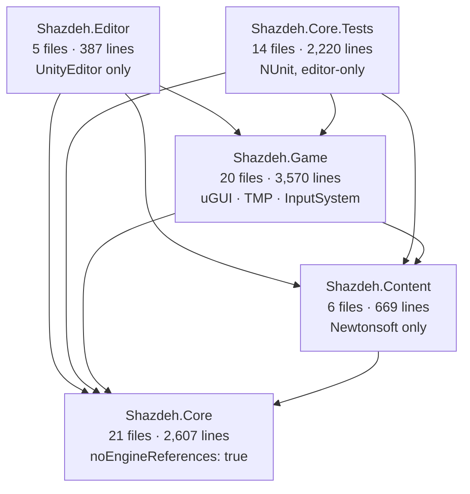
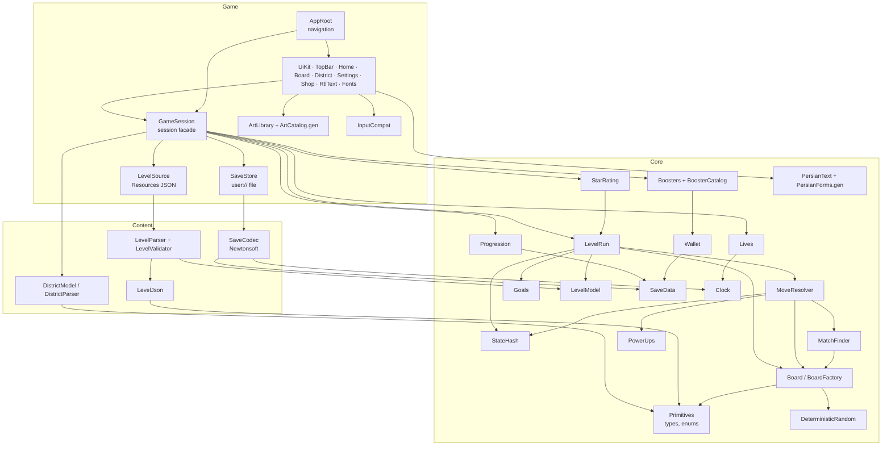
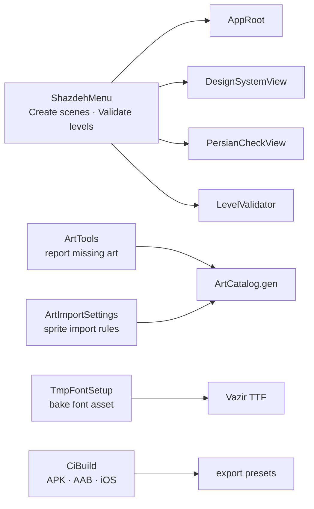

# Dependency graph of the Unity project, and the Godot shape it implies

Derived from the `namespace`, `types` and `engine_deps` columns of
[`02-inventory.csv`](02-inventory.csv) and from the five `*.asmdef` files (which are the project's own
declaration of who may reference whom).

## 1. Assemblies (as the project declares them)



`Core` has no engine reference at all — that is the single most useful fact in this audit. 2,607 lines
of the game (the rules, the economy, the save model, the text shaper) can be tested and ported without a
renderer, a window or a device.

## 2. Runtime graph, system level



Notes that matter for the port:

- **`GameSession` is the only façade the screens know.** Screens call `Session.*` and nothing else; the
  arrow never points from `Core` upwards. In Godot this is an autoload (`Game` singleton) or a
  `Resource`-held object passed down — the audit recommends an **autoload**, because every screen and the
  HUD need it and there is exactly one.
- **`AppRoot` is the whole navigation graph** (six transitions: home ↔ districts, home ↔ settings,
  home ↔ shop, home → board, board → home). In Godot this becomes a `Main.tscn` with a screen stack and
  `change_scene_to_packed` or a `Control` switcher; the one-way rule (a screen never knows another
  screen) should survive the port.
- **`LevelSource` reads JSON from `Resources/`** with no async; Godot equivalent: `FileAccess` +
  `JSON`, or `Resource` files loaded synchronously. Keep it synchronous — 10 levels, 10 KiB.
- **`ArtLibrary` is a registry with a guaranteed placeholder** (missing art → token-coloured shape). That
  property is what let the art arrive gradually and it is worth keeping in the port: it makes the Godot
  build runnable before any sprite is imported.

## 3. Editor-side graph (dropped or relocated)



These five files do not exist at runtime in Unity either — they are menu items. In Godot they become:

| Unity editor script | Godot destination | why |
| --- | --- | --- |
| `ShazdehMenu` (scenes) | the `.tscn` files themselves + `Main.tscn` | scenes are authored files now, not generated |
| `ShazdehMenu` (validate levels) | `godot-port/tools/validate_levels.gd` run with `--headless -s` | a CI step that can fail a build |
| `ArtTools` | `godot-port/tools/art_report.gd` | same |
| `ArtImportSettings` | `.import` settings + a documented import table | Godot has no per-folder import rules; document and enforce with a check script |
| `TmpFontSetup` | nothing | Godot imports the TTF directly |
| `CiBuild` | `export_presets.cfg` + a `--export-release` CI job | see `03-compatibility.md` §4 |

## 4. What this implies for the Godot project shape

```
godot-port/
  project.godot                 415×738 base, canvas_items/expand, portrait, compatibility renderer
  export_presets.cfg            Android (arm64 + armv7), debug + release
  scenes/
    Main.tscn                   the screen host (was AppRoot)
    ui/{TopBar,Home,Board,Districts,Settings,Shop}.tscn
    dev/{DesignSystem,PersianCheck}.tscn
    board/{BoardView,Cell,Piece}.tscn
  scripts/
    core/**                     one .gd per Core file, class_name, no Node dependency
    content/**                  parsers + validator + save codec
    game/**                     autoloads: Game, Saves, Art, Content
    ui/**                       screen scripts
  assets/
    art/**.png                  copied from client/Assets/Game/Resources/art (85)
    fonts/Vazir-{Medium,Bold}.ttf
    content/levels/**           copied JSON (10 + districts meta)
  test/                         GUT suite, ported 1:1 from the 152 C# tests
  tools/                        validate_levels.gd, art_report.gd, regenerate_tokens.gd, regenerate_catalog.gd
```

The `core/**` folder must not `preload`, `load` or reference `Node`, `SceneTree` or `Input` — the same
rule Unity expressed as `"noEngineReferences": true`, and the same rule that keeps 2,607 lines testable
in headless CI.
